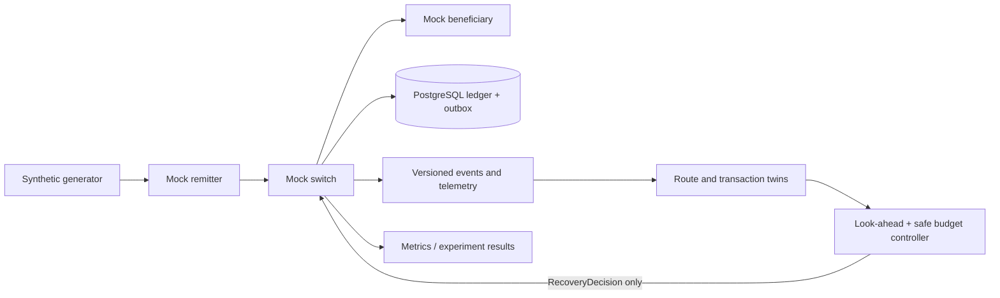

# AORT-AWS

**Security-Aware Digital-Twin-Controlled Recovery of Ambiguous Banking Transactions**

AORT-AWS is an academic, synthetic payment-network laboratory. It studies a feedback loop in which payment timeouts cause status inquiries, those inquiries consume already scarce switch capacity, and additional payments then become ambiguous. A route/transaction digital twin evaluates safe inquiry budgets while the mock backend enforces identity, quotas, credits, replay protection, and ledger invariants.

> This repository never connects to NPCI, UPI, real banks, real accounts, or customer data. The controller recommends inquiry, wait, or escalation; it cannot move funds or certify a financial outcome.

## Research hypothesis

A calibrated, safety-constrained recovery controller may improve payment goodput and ambiguous-transaction resolution time during faults compared with static, immediate-retry, backoff, and proportional baselines. This is a hypothesis to test, not an established claim of academic or legal novelty. T+1 turnaround, infrastructure RTO, and database RPO are distinct measures; no RPO improvement is claimed.

## Architecture



Services exchange only models in `contracts/v1`; neither side imports the other side's internals. PostgreSQL is the proposed authoritative ledger. Digital twins, queues, dashboards, and ML output are projections.

## Implemented now

- Strict Pydantic v1 contracts and checked-in JSON Schema generation.
- Dependency-free slowdown simulation, synthetic generator, twin projections, safe fallback controller, and standalone controller API.
- Mock remitter, switch, and beneficiary health/payment/status endpoints. Accepted payments remain `unknown`; the starter never fabricates completed transfers.
- Balanced/idempotent SQLAlchemy ledger operation, optimistic transaction version update, and transactional outbox schema.
- HMAC verification, per-bank quotas, route credits, telemetry source/sequence/time checks, replay prefilter, and local-only attack generators.
- CI, dependency/secret scanning, CODEOWNERS, and a fail-closed trusted-base ownership validator that handles deleted and renamed paths.
- Docker Compose for PostgreSQL and four local services.

Planned work includes a real beneficiary evidence client, persistent check queue, migrations, trained/calibrated models, dashboard charts, full experiment matrix, observability, and reviewed AWS provisioning.

## Ownership and Git workflow

| Developer | Branch | Strictly owned paths |
|---|---|---|
| `@kolursamith` | `feature/intelligence` | `intelligence/`, `results/` |
| `@girinandanv9845-ship-it` | `feature/backend` | `backend/`, `dashboard/`, `infra/` |

`contracts/`, `tests/contracts/`, `.github/`, `docs/`, and root configuration are shared. Feature PRs target `developer`; reviewed integration PRs promote `developer` to `main`. Both permanent branches should require one approval from the non-author, code-owner review, stale-review dismissal, and the three required checks documented in [GitHub setup](docs/GITHUB_SETUP.md).

Both people appear in CODEOWNERS so the non-author remains an eligible code-owner reviewer. The ownership workflow—not CODEOWNERS—enforces author/path admission.

## Local installation

Python 3.11 or 3.12 is recommended.

```bash
python3.12 -m venv .venv
source .venv/bin/activate
python -m pip install -e '.[dev]'
cp .env.example .env
pytest
```

Run the independent intelligence side:

```bash
python -m intelligence.simulation.engine
uvicorn intelligence.controller.api:app --port 8005
```

Run the independently mocked banking environment:

```bash
docker compose -f infra/docker-compose.yml up --build
```

Health URLs are controller `:8005/health`, switch `:8000/health`, remitter `:8001/health`, and beneficiary `:8002/health`.

## Example API calls

```bash
curl -s http://localhost:8005/v1/recovery/decisions \
  -H 'content-type: application/json' \
  -d '{"experiment_id":"demo","route_id":"route-1","estimated_capacity_rps":40,"confidence":0.5,"pending_transaction_ids":["txn-1"]}'
```

```bash
curl -s http://localhost:8000/v1/status-checks \
  -H 'content-type: application/json' -H 'x-bank-id: bank-1' \
  -d '{"transaction_id":"txn-1","route_id":"route-1","check_id":"check-1"}'
```

The switch returns a non-authoritative `unknown` until validated beneficiary evidence is wired in.

## Security experiments

The three test scenarios are status-check flooding, telemetry poisoning, and replay/reordering. Generators accept only explicit local/Docker mock targets. See [Security](docs/SECURITY.md) for controls and limitations.

## AWS direction

The first deployment candidate is a reviewed EC2 Compose host plus CloudWatch and private S3. The longer course target may use ECS Fargate, RDS PostgreSQL, and SQS. No infrastructure is provisioned by this starter and `infra/deploy.sh` intentionally exits. See [AWS architecture](infra/aws/README.md).

## Documentation

- [Architecture](docs/ARCHITECTURE.md)
- [System design](docs/SYSTEM_DESIGN.md)
- [API contracts](docs/API_CONTRACTS.md)
- [Security](docs/SECURITY.md)
- [Team workflow](docs/TEAM_WORKFLOW.md)
- [GitHub setup](docs/GITHUB_SETUP.md)
- [48-hour MVP](docs/HACKATHON_PLAN.md)
- [12-day roadmap](docs/TWELVE_DAY_ROADMAP.md)
- [Experiments](docs/EXPERIMENTS.md)

## Limitations

This is a research scaffold, not a payment product. The in-memory quota/credit state is single-process, database migrations are not yet included, beneficiary evidence is mocked, models are untrained, and no AWS deployment or branch protection has been asserted without external verification.
