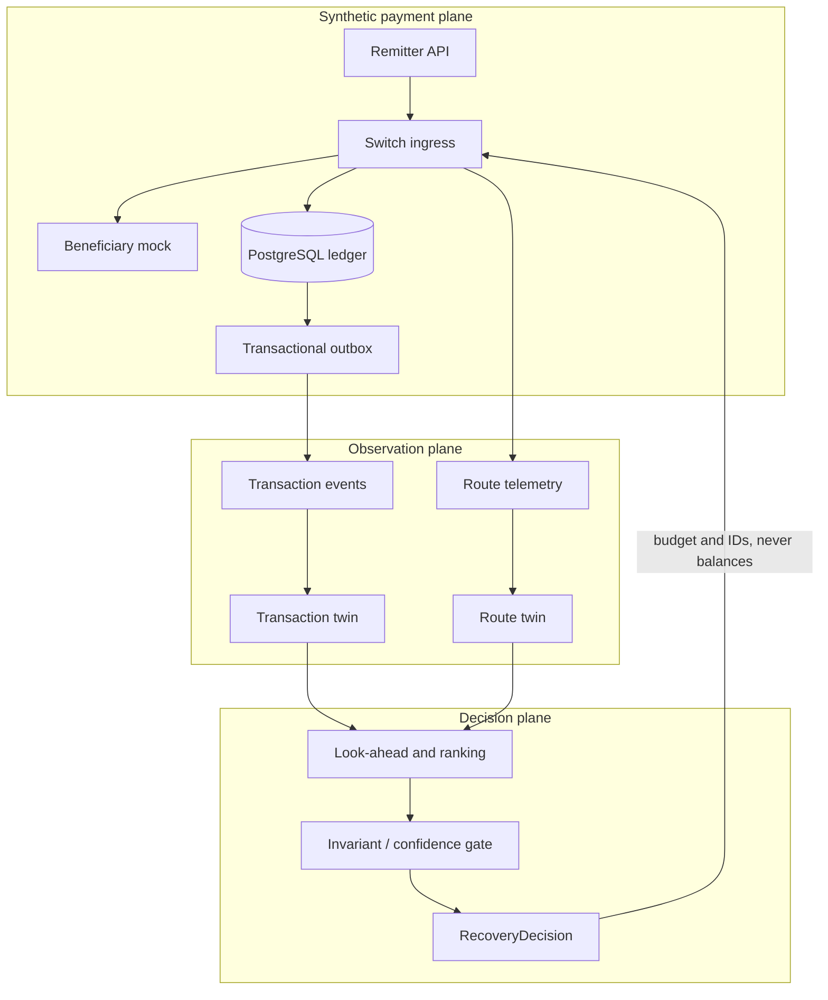

# Architecture

## Trust and data-flow boundaries

The payment plane owns financial truth. The observation plane contains delayed and possibly hostile evidence. The decision plane is advisory. Cross-plane communication uses `contracts/v1` and documented HTTP APIs.

## Local deployment

Compose starts PostgreSQL and isolated controller, switch, remitter, and beneficiary containers. The intelligence simulator and controller can run without any banking service. The banking APIs default to fixed credits and need no ML model.

## AWS evolution

The MVP maps containers to one controlled EC2 host. The course design maps stateless services to ECS, PostgreSQL to RDS, check dispatch to SQS, and logs/metrics to CloudWatch. S3 holds synthetic experiment artifacts. DynamoDB is omitted unless a measured twin access pattern justifies it.
