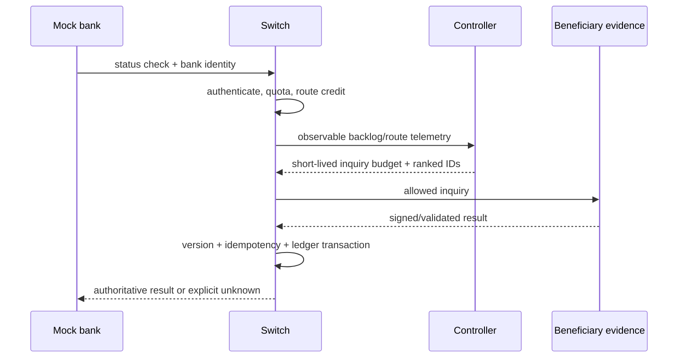

# System design

## Core invariants

1. `unknown` is a first-class outcome and is never converted to failure merely because a timeout occurred.
2. Only validated backend evidence may produce `authoritative=true`; the controller cannot create a `StatusCheckResult`.
3. A unique financial operation and its postings/outbox record share one database transaction.
4. Postings must sum to zero within the modeled accounting boundary.
5. Transaction state advances only from the expected version; stale writers affect zero rows.
6. Unsupported reversals are not exposed by the starter API.

## Recovery flow

The current switch implements the ingress gates and explicit unknown response. Evidence retrieval, persistent dispatch, and ledger application remain planned integration work.

## Failure behavior

- Missing model: use conservative fallback.
- Low-confidence/anomalous telemetry: reduce budget.
- Exhausted quota/credits: structured HTTP 429; do not enqueue.
- Duplicate operation: return idempotent no-op after database uniqueness check.
- Stale version: reject without overwriting.
- Database unavailable: fail the financial operation; never report success.
