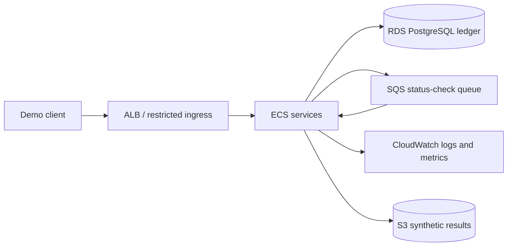

# AWS target architecture

RDS is the only proposed financial source of truth. SQS and any twin store are projections or delivery mechanisms, not participants in a fictional cross-database atomic transaction.
